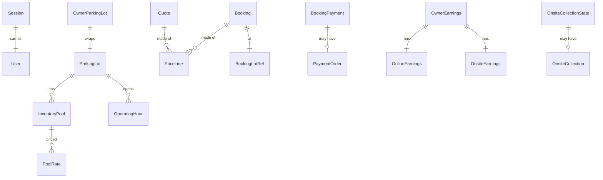

# Data Model

The types the app uses for everything the API sends and receives, and what the app stores on the device.

> **Status:** **Implemented** and tested: the core types and every model listed here. **Planned:** the API client, repositories and device storage that use them.

The source of truth for shapes is `docs/api/openapi.yaml` in the API repository. These models were written from that file and from the API's enums. When the API changes, change the model and its test in the same PR.

## Principles

| Principle | How it is done |
|---|---|
| Money is never a `double` | Amounts are `Decimal`, read from the API's string by `MoneyAmountConverter`. A model exposes a `Money` (amount + currency) getter where a screen needs one. `Money` has no arithmetic: the app does not calculate prices |
| Time is UTC | `UtcDateTimeConverter` reads any ISO timestamp into a UTC `DateTime` and writes `2026-11-02T04:30:00Z`. Display in the facility's timezone is the UI's job |
| An unknown enum value never crashes | Every enum has `unknown`, and every enum field is declared with `unknownEnumValue`. The API can add a status before the app is updated |
| An unknown field is ignored | Generated parsers read only the fields they know |
| An unknown status is never treated as success | Code compares with the specific value (`== succeeded`), never "not failed" |
| IDs are opaque strings | No parsing, no ordering by ID |
| Models are immutable | `freezed`; change by `copyWith` |
| Nullable only where the API says so | A list the API might omit defaults to empty instead of null |

Each of these has a test.

## Core types (`lib/core`)

| Type | File | Purpose |
|---|---|---|
| `Money` | `core/money/money.dart` | Amount and currency; parse, compare, write |
| `MoneyAmountConverter`, `DecimalConverter`, `UtcDateTimeConverter`, `FlexibleDoubleConverter`, `JsonObjectConverter` | `core/api/json_converters.dart` | How single JSON values become Dart values |
| `ApiErrorCode` | `core/api/api_error_code.dart` | Every documented error code, plus `network`, `timeout`, `unknown` |
| `ApiException` | `core/api/api_exception.dart` | The one failure type; built from the error envelope |
| `CursorPage<T>`, `NumberedPage<T>` | `core/api/pagination.dart` | One page of a list |

## Models by feature

Each lives in `lib/features/<feature>/data/models/`, one type per file.



| Feature | Responses | Requests | Enums |
|---|---|---|---|
| `auth` | `OtpChallenge`, `Session`, `User` | — | `UserRole`, `UserStatus` |
| `parking_lot` | `ParkingLot`, `ParkingLotSummary`, `PoolSummary`, `InventoryPool`, `PoolRate`, `OperatingHour`, `CodeName` | — | `BookingMode`, `RateType`, `AllocationMode` |
| `booking` | `Availability`, `Quote`, `PriceLine`, `Booking`, `BookingLotRef` | `BookingWindowRequest`, `CreateBookingRequest` | `BookingStatus`, `PaymentMode` |
| `payment` | `BookingPayment`, `PaymentOrder` | — | `PaymentOrderStatus` |
| `notifications` | `AppNotification` | — | — (the type is kept as text) |
| `owner` | `ParkingOwner`, `OwnerParkingLot`, `ParkingLotOptions`, `OnsiteCollectionState`, `OnsiteCollection`, `OwnerEarnings`, `OnlineEarnings`, `OnsiteEarnings`, `EarningEntry` | `OwnerApplicationInput`, `ParkingLotInput`, `OperatingHourInput` | `VerificationStatus`, `ApprovalStatus`, `EarningKind` |

`search` has no models of its own: it shows `ParkingLotSummary`.

### Notes on particular models

- **`Booking`** is the same shape for the customer and the owner, and never carries the customer's identity. `isCheckedIn` is the only derived fact; everything else is what the API returned.
- **`OwnerParkingLot`** wraps `ParkingLot`: the API sends the review fields beside the public ones in one object, and the model reads both from it.
- **`ParkingLotInput`** has every field optional and omits nulls when written, so one type serves create and partial update.
- **`PaymentOrder.checkout`** is a free-form map because its contents belong to the payment provider. Only the payment feature reads it.
- **`AppNotification.payload`** is a map; an empty PHP array (`[]`) is read as an empty map. An unknown `type` is still shown with its title and body.
- **Coordinates** accept a number or a numeric string.

### Not modelled yet

| Missing | Why |
|---|---|
| Admin settings | The app has no admin area |
| Typed checkout details for Razorpay | Added with the payment feature, behind the payment wrapper |

## Importing models

A feature may import **another feature's models** (`data/models/`), because a booking screen needs `BookingMode` from `parking_lot`, and the owner area shows `Booking`. It may not import another feature's repository or UI. See [architecture.md](../conventions/architecture.md).

## Stored on the device

The app keeps almost nothing. There is no local database.

| Item | Where | Lifetime |
|---|---|---|
| Access token and its expiry | Secure storage (Keychain / Keystore), `core/auth` only | Until sign-out, expiry or `UNAUTHENTICATED` |
| The area last used (customer or owner) | Plain preferences | Until sign-out |
| Whether the location explanation was shown | Plain preferences | Kept |
| Everything else (bookings, facilities, profile) | Memory only | Until the app closes |

Nothing that identifies the user is written outside secure storage. Showing a booking without a network (open decision MD-10) would add a cache, and is not designed yet. Device storage is **Planned**: it arrives with sign-in.

## Code generation

Models use `freezed` and `json_serializable`. Generated files (`*.freezed.dart`, `*.g.dart`) are not committed.

```bash
dart run build_runner build --delete-conflicting-outputs
```

`dart run tool/check.dart` runs it for you. Settings are in `build.yaml`: JSON keys are snake_case, and null fields are left out when writing.

## Adding or changing a model

1. Find the schema in `openapi.yaml`. Do not guess a shape.
2. One file per type in the feature's `data/models/`. Follow an existing model: converters on money and time fields, `unknownEnumValue` on every enum field, defaults for lists.
3. Add a test with the documented JSON, an unknown enum value and an extra field.
4. Add the type to the table above.
