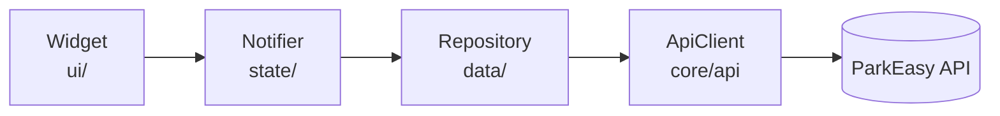

# Architecture

Decision records: [ADR-0002](../adr/0002-technology-stack.md), [ADR-0003](../adr/0003-feature-first-structure.md).

> **Status:** Confirmed. No code exists yet; the first feature (sign-in) will be the worked example.

## The flow of one screen

| Layer | Folder | Does | Must not |
|---|---|---|---|
| Widget | `features/<f>/ui` | Draws state, sends user actions to the notifier | Call a repository, `dio` or storage; hold business state |
| Notifier | `features/<f>/state` | Holds the screen's state, calls repositories, turns failures into state | Import Flutter widgets or use `BuildContext` |
| Repository | `features/<f>/data` | One method per API call; maps JSON to models | Hold state; know about widgets |
| API client | `core/api` | HTTP, token, headers, envelope, error mapping | Know about any feature |

## Folders

| Folder | Contents |
|---|---|
| `lib/app` | The root widget, the router, wiring of the theme |
| `lib/core/api` | `ApiClient`, `ApiException`, error codes, pagination, idempotency keys |
| `lib/core/auth` | Token storage and the session (signed in or not, roles) |
| `lib/core/config` | `AppConfig` |
| `lib/core/money` | The money type and its formatting |
| `lib/core/theme` | Colour, typography, spacing and radius tokens; the `ThemeData` |
| `lib/core/widgets` | Components used by more than one feature |
| `lib/features/<f>/data` | Repository, request and response models |
| `lib/features/<f>/state` | Notifiers and their state classes |
| `lib/features/<f>/ui` | Screens and the widgets only this feature uses |
| `lib/l10n` | ARB files |

## Import rules

| From | May import |
|---|---|
| `core/*` | Other `core/*`, packages. Never a feature. |
| `features/a/ui` | `features/a/state`, `features/a/data` models, `core/*` |
| `features/a/state` | `features/a/data`, `core/*`, and another feature's **state** when it genuinely needs it (for example the session) |
| `features/a/data` | `core/*` |
| `app/` | Everything; it is where features are wired together |

A feature never imports another feature's `data` or `ui`. If two features need the same model or widget, it moves to `core`. Navigation to another feature goes through a route name, not an import of its screen.

Imports inside `lib` are package imports (`package:parkeasy/...`), never relative.

## Naming

| Thing | Name | File |
|---|---|---|
| Screen | `BookingDetailsScreen` | `booking_details_screen.dart` |
| Notifier | `BookingDetailsNotifier` | `booking_details_notifier.dart` |
| Repository | `BookingRepository` | `booking_repository.dart` |
| Model | `Booking`, `Quote` | `booking.dart` |
| Provider | `bookingRepositoryProvider` | Beside what it provides |

One public class per file. A screen file contains the screen; its private sub-widgets may live in the same file until it passes about 200 lines.

## Roles

The customer and owner areas are two navigation shells under one router ([ADR-0001](../adr/0001-one-app-two-roles.md)). Everything owner-only lives in `features/owner`. The role decides what is shown; the API decides what is allowed.
